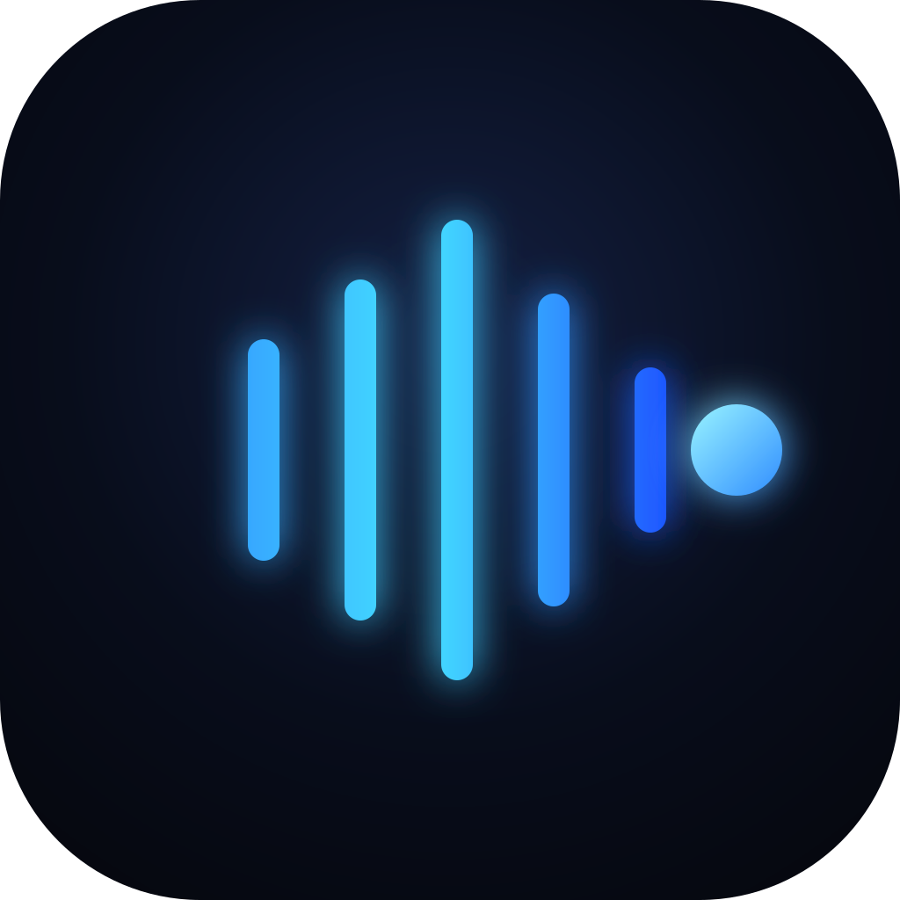

# Scroatt — gravador de voz com transcrição

MVP mobile em **Flutter** que reproduz fielmente o protótipo de interface
fornecido: um gravador de voz com três telas (boas-vindas, gravação e edição),
gravação real de áudio, waveform ao vivo e edição de transcrição.



---

## Sumário

- [Funcionalidades](#funcionalidades)
- [Telas](#telas)
- [Stack](#stack)
- [Estrutura do projeto](#estrutura-do-projeto)
- [Como compilar](#como-compilar)
- [CI/CD — APK no GitHub Actions](#cicd--apk-no-github-actions)
- [Notificações com ações de acesso rápido](#notificações-com-ações-de-acesso-rápido)
- [Design](#design)
- [Validação local](#validação-local)
- [Limitações conhecidas](#limitações-conhecidas)

---

## Funcionalidades

| Área | Detalhe |
|---|---|
| **Gravação** | Captura real via `record` (AAC-LC, 128 kbps, 44.1 kHz, mono) com medição de amplitude em tempo real |
| **Waveform** | Desenhada com `CustomPainter` — malha luminosa durante a gravação, barras com cursor no editor |
| **Transcrição** | Campo editável, salvo automaticamente como rascunho e finalizado na tela de edição |
| **Edição** | Trim com `RangeSlider`, ganho de volume, enhancer de voz, reprodução com seek |
| **Biblioteca** | Lista de gravações com busca por título/texto, duração total agregada e estado vazio |
| **Permissões** | Detecção de recusa temporária vs. permanente, com atalho para as Configurações do sistema |
| **Ajustes** | Idioma de transcrição, qualidade do áudio, filtros de gravação (redução de ruído, ganho automático, cancelamento de eco) |

---

## Telas

### 1. Welcome — `lib/features/onboarding/welcome_screen.dart`

Título em duas linhas, subtítulo, **orbe luminoso** animado (o nó de fita azul
do mockup) e a pílula `Start Now` entre chevrons.

### 2. Record — `lib/features/record/record_screen.dart`

Barra superior com voltar / `Record` / ajustes. No centro, a **malha de onda
luminosa** reativa à amplitude do microfone, a frase transcrita e o contador
de duração. Na base, os controles de filtro, o **botão de gravação pulsante**
e o marcador de momentos.

### 3. Editing — `lib/features/editing/editing_screen.dart`

Transcrição editável, tempo decorrido, waveform com cursor arrastável, barra
de reprodução e a **barra de ferramentas** com as quatro ações do protótipo
(`Tt` Texto, `X✂` Trim, `Volume`, `Enhance`).

### 4. Library — `lib/features/library/library_screen.dart`

Lista de todas as gravações com capa, título, prévia da transcrição e duração.

---

## Stack

| Camada | Escolha |
|---|---|
| Framework | Flutter 3.35.7 (Dart 3.9.2) |
| Gravação | [`record`](https://pub.dev/packages/record) 6.x — AAC-LC nativo do Android |
| Reprodução | [`just_audio`](https://pub.dev/packages/just_audio) 0.9.x |
| Permissões | [`permission_handler`](https://pub.dev/packages/permission_handler) 11.x |
| Persistência | [`shared_preferences`](https://pub.dev/packages/shared_preferences) 2.x |
| Ícones | [`flutter_svg`](https://pub.dev/packages/flutter_svg) + assets **Feather Icons** (MIT) |
| Tipografia | **Inter** (SIL Open Font License), empacotada como `.ttf` |
| Android | Gradle 8.10.2, AGP 8.7.0, Kotlin 2.1.0, `minSdk` 24 |

---

## Estrutura do projeto

```
.
├── app/                              # projeto Flutter
│   ├── android/                      # projeto Android nativo
│   ├── assets/
│   │   ├── fonts/                    # Inter (Regular/Medium/SemiBold/Bold)
│   │   └── icons/                    # Feather Icons em SVG + LICENSE
│   ├── lib/
│   │   ├── core/
│   │   │   ├── theme/                # paleta, tipografia, tema Material 3
│   │   │   ├── utils/                # formatadores de tempo e tamanho
│   │   │   └── widgets/              # AppIcon, WaveformView, GlowOrb
│   │   ├── features/
│   │   │   ├── onboarding/           # tela de boas-vindas
│   │   │   ├── record/               # tela de gravação
│   │   │   ├── editing/              # tela de edição
│   │   │   └── library/              # biblioteca de gravações
│   │   ├── models/                   # Recording
│   │   ├── services/                 # recorder, player, repository
│   │   └── main.dart
│   ├── test/                         # testes unitários e de widget
│   └── pubspec.yaml
├── tools/                            # scripts de apoio (fonte → TTF, ícones, validação)
└── .github/workflows/build-apk.yml   # CI: compila e publica o APK
```

A organização segue **feature-first**: cada tela vive em sua própria pasta e
depende de `core/` (tema, widgets, utilitários) e `services/` (áudio e
persistência). Nenhuma tela fala direto com o plugin nativo — tudo passa pelos
serviços.

---

## Como compilar

### Pré-requisitos

- Flutter `>= 3.35.7` (Dart 3.9.2)
- Android SDK 35 e JDK 17

### Desenvolvimento local

```bash
cd app
flutter pub get
flutter run              # em um dispositivo/emulador Android
```

### APK local

```bash
cd app
flutter build apk --debug      # app/build/app/outputs/flutter-apk/app-debug.apk
flutter build apk --release    # release assinado com a chave de debug
```

> O `build.gradle` assina o build de release com a chave de **debug** para
> que o CI funcione sem segredos. Para produção, substitua por um keystore
> próprio via `key.properties`.

---

## CI/CD — APK no GitHub Actions

O workflow [`build-apk.yml`](.github/workflows/build-apk.yml) roda em cada push
para `main` ou branches `arena/**`, em todo PR e manualmente
(`workflow_dispatch`).

**Pipeline:**

1. Instala o Flutter e o JDK 17 via `subosito/flutter-action`.
2. Configura o Android SDK e aceita as licenças.
3. `flutter pub get` (com cache do `pub-cache`).
4. `flutter analyze --no-fatal-infos` — não bloqueia o build.
5. `flutter build apk --debug` (ou `--release --split-per-abi`).
6. Publica os `.apk` como **artefato baixável** do run
   (`scroatt-apk-debug` / `scroatt-apk-release`).
7. Se a ref for uma tag `v*`, cria um *draft release* com os APKs anexados.

### Baixando o artefato

Na aba **Actions** do repositório, abra o run desejado e baixe o artefato
`scrott-apk-debug` no rodapé da página. Via CLI:

```bash
gh run download <run-id> -n scrott-apk-debug
```

### Build manual com escolha do tipo

```bash
gh workflow run build-apk -f build_type=release
```

---

## Notificações com ações de acesso rápido

Enquanto a gravação está em andamento, o app publica uma **notificação
persistente** na barra de status. Ela é mantida por um serviço Android em
primeiro plano (`RecordingService`), de modo que continua ativa mesmo com o
app em segundo plano.

**Temporizador sincronizado.** A notificação e a tela compartilham a mesma
fonte de tempo: o `_elapsed` do `RecordScreen`. A notificação é atualizada a
cada segundo pelo `NotificationService.startTicker()`, que recebe o tempo
corrente por callback — nunca uma cópia congelada. O valor exibido na
notificação e o exibido na tela são, portanto, sempre idênticos.

**Ações disponíveis.** O Android aceita até três botões por notificação:

| Estado | Botões na notificação |
| --- | --- |
| Gravando | **Pause** · **Stop** |
| Pausado | **Resume** · **Restart** · **Stop** |

- **Pause** — congela a captura mantendo o áudio já gravado.
- **Resume** — retoma a captura de onde parou.
- **Restart** — zera o temporizador da gravação, preservando o áudio.
- **Stop** — finaliza a gravação e abre a tela de edição.

As ações chegam ao Dart por dois caminhos: o `MethodChannel`
`com.scrott.voice/recorder_actions` (quando o serviço nativo recebe o
toque) e o callback `onDidReceiveNotificationResponse` do
`flutter_local_notifications`. Ambos desembocam no mesmo handler
`_handleRecorderAction`, que aplica a operação no `AudioRecorderService` e
republica a notificação com o novo estado.

**Permissões Android.** `POST_NOTIFICATIONS` (Android 13+),
`FOREGROUND_SERVICE` e `FOREGROUND_SERVICE_MICROPHONE`. O serviço declara
`foregroundServiceType="microphone"`.

## Design

### Paleta

Extraída do mockup — um "dark glass" azul profundo com acentos em ciano
elétrico. Definida em `lib/core/theme/app_colors.dart`.

| Token | Valor | Uso |
|---|---|---|
| `background` | `#05070D` | fundo do app |
| `surface` | `#10172A` | cards e campos |
| `waveDeep` | `#1B4DFF` | azul profundo da onda |
| `waveBright` | `#46E0FF` | ciano de destaque |
| `accent` | `#2F6BFF` | botões primários |
| `record` | `#FF3B5C` | estado gravando |

### Ícones

Todos os ícones vêm do set **Feather Icons** (MIT, © Cole Bemis), empacotado
como SVG em `app/assets/icons/`. A escolha do Feather se dá porque o mockup
usa exatamente esse DNA: traço fino uniforme de 2 px com cantos arredondados.

A seleção foi feita **por encaixe no perfil do app**, não por semelhança
visual genérica:

| Ação | Ícone | Porquê |
|---|---|---|
| Gravar | `mic` | metáfora universal de captura de voz |
| Parar | `square` | forma de "stop" dos players de mídia |
| Texto / `Tt` | `type` | o próprio mockup usa um glifo "Tt" |
| Trim / `X✂` | `sliders` | corte/ajuste de faixa |
| Volume | `volume-2` | controle de ganho |
| Enhance | `zap` | realce rápido,，符合 a ideia de "melhorar" |
| Marcar momento | `bookmark` | marcador dentro da linha do tempo |
| Filtros | `sliders` | equalizador de gravação |
| Localizar | `globe` | idioma |

O catálogo central fica em `lib/core/widgets/app_icon.dart` — um único lugar
para consultar e trocar qualquer ícone.

### Onda e orbe

`WaveformView` desenha duas variantes com `CustomPainter`:

- **`mesh`** — malha de curvas sobrepostas com gradiente azul→ciano e
  `MaskFilter.blur` para o halo luminoso (tela de gravação);
- **`bars`** — barras arredondadas com destaque da parte já reproduzida
  (tela de edição).

`GlowOrb` desenha a fita tridimensional da tela inicial com 7 camadas de
curvas Bézier em gradiente ciano→azul.

---

## Validação local

Como o SDK do Flutter não está disponível em todos os ambientes, o repositório
traz ferramentas de verificação que rodam sem rede:

```bash
# Sintaxe Dart (gramática tree-sitter compilada localmente)
python3 tools/validate_dart.py app

# Imports, assets e símbolos do projeto
python3 tools/check_references.py app

# Imports e variáveis locais sem uso
python3 tools/check_unused.py app
```

Para preparar o ambiente das ferramentas:

```bash
python3 -m venv .venv && .venv/bin/pip install tree_sitter
./tools/build_dart_grammar.sh
```

---

## Limitações conhecidas

- **Transcrição automática**: o MVP carrega o texto a partir do rascunho
  digitado pelo usuário. Conectar um serviço de *speech-to-text* (Google,
  Whisper local, ou a Speech Recognition API do Android) é o próximo passo
  natural — a camada `Recording.transcript` já está isolada para isso.
- **Filtros de áudio**: os interruptores de ruído/eco na tela de ajustes
  controlam a captura nativa (`RecordConfig.autoGain`, `noiseSuppress`,
  `echoCancel`); o *enhancer* visual ainda não processa o arquivo gravado.
- **Trim**: a faixa selecionada atualiza a duração exibida e a posição de
  reprodução, mas ainda não recorta o arquivo de áudio em disco.
- **iOS**: o projeto está configurado apenas para Android. O `ios/` gerado
  por `flutter create` precisa ser adicionado com as chaves
  `NSMicrophoneUsageDescription` e `NSAppTransportSecurity`.

---

## Licenças

| Componente | Licença |
|---|---|
| Feather Icons (ícones SVG) | MIT — ver `app/assets/icons/LICENSE.txt` |
| Inter (tipografia) | SIL Open Font License 1.1 |
| Código do projeto | MIT |
